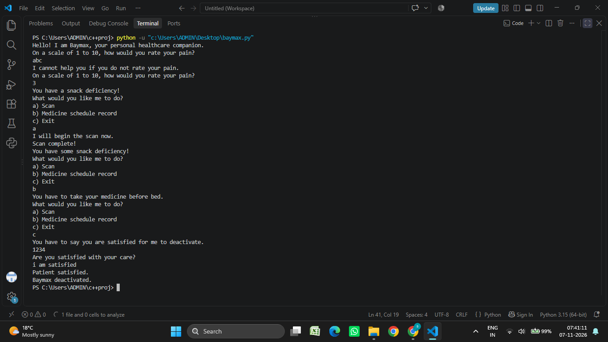

# Baymax Project

Building a Baymax-style health assistant in public, one level at a time.

## Current level: 0 (terminal)



Baymax asks how much pain you're in, reacts, and keeps helping until
you tell him you're satisfied with your care.

### Features
- Pain check (1 to 10) with input validation
- Random reactions for each pain range
- Menu: scan, medicine schedule record (placeholder), exit
- Proper goodbye flow: Baymax only deactivates when you say you're satisfied

## Run it
```bash
python baymax.py
```
Requires Python 3. No extra packages.

## Roadmap
- [x] Level 0: terminal Baymax with pain check, menu, and exit flow
- [ ] Level 1: scan that uses your pain score
- [ ] Level 2: coming soon
- [ ] Level 3: real medicine reminders
