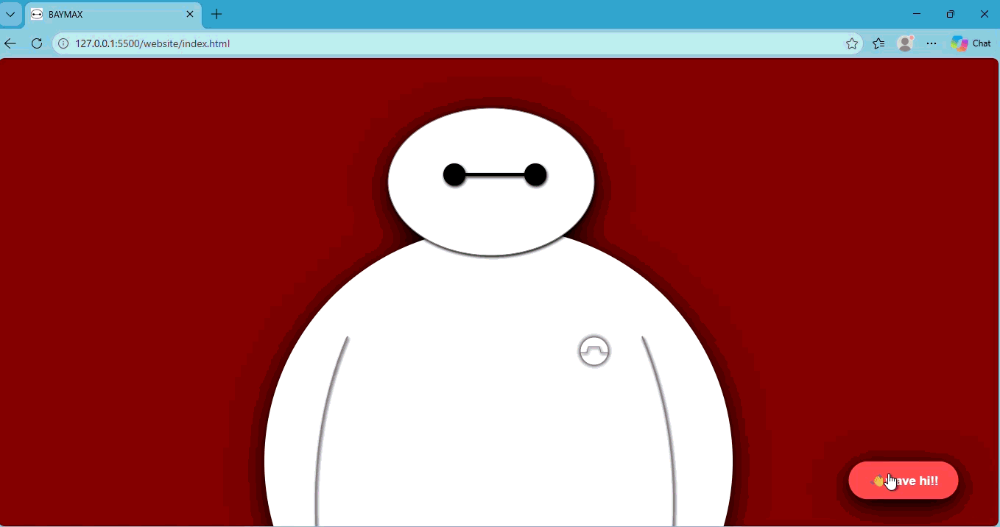
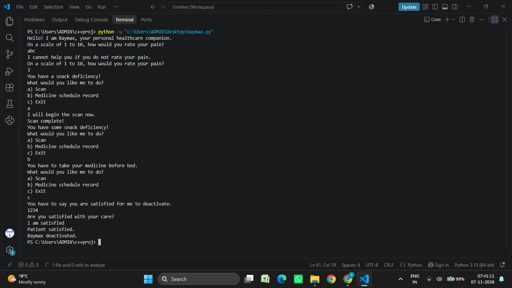

# Baymax Project

Building a Baymax-style health assistant in public, one level at a time.

## Current level: 1 (web face, in progress)



An SVG Baymax that blinks, tilts his head in confusion, and waves hi when you click a button.

### Level 1 features
- Baymax drawn from scratch in SVG
- CSS animations and shadows
- Blinking and a confused head tilt
- "Wave hi" button that makes him wave
- Inline CSS and JS in the HTML, plus an external CSS file

### Run it
Open `level-1-web/index.html` in your browser. No installs needed.

## Level 0 (done): terminal Baymax



Baymax asks how much pain you're in, reacts, and keeps helping until you tell him you're satisfied with your care.

- Pain check (1 to 10) with input validation
- Random reactions for each pain range
- Menu: scan, medicine schedule record (placeholder), exit
- Proper goodbye flow: Baymax only deactivates when you say you're satisfied

### Run it
```bash
python baymax.py
```
Requires Python 3. No extra packages.

## Roadmap
- [x] Level 0: terminal Baymax with pain check, menu, and exit flow
- [ ] Level 1: animated web face
  - [x] SVG Baymax with blink, head tilt, and wave
  - [ ] Inflating loading screen
  - [ ] Real loading progress and retry
- [ ] Level 2: personality and chat engine
- [ ] Level 3: health log (typed or spoken)
- [ ] Level 4: face recognition (local only)
